# Worksuite Assets

Original animated motion graphics for Worksuite FrameFlow, made entirely from code in
[`scripts/assets/pack`](../../scripts/assets/pack). They are Lottie files (30 fps, no text
layers) with colour slots, so the editor can recolour them. Licence: MIT, like the rest of the repository.

Rebuild with `bun scripts/assets/build-worksuite-pack.ts` and check with
`bun scripts/assets/validate-worksuite-pack.ts`. Do not edit the generated files by hand.

## Lower thirds (10)

| Preview | Asset | Length | Colours |
| --- | --- | --- | --- |
|  | **Bar slide** `lt-bar-slide` An accent line grows, then a title bar and a subtitle bar slide out from it. | 4 s | Title bar `#4C8DFF` Subtitle bar `#0F1115` Accent `#F5A524` |
|  | **Pill pop** `lt-pill-pop` A rounded pill pops in with a pulsing dot on its left edge. | 4 s | Pill `#FFFFFF` Dot `#2EC4B6` Ring `#4C8DFF` |
| 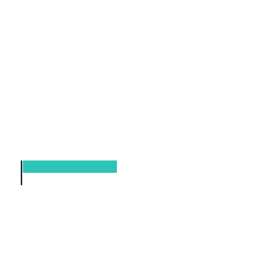 | **Double stack** `lt-double-stack` Two stacked bars drop into place one after the other. | 4 s | Top bar `#2EC4B6` Bottom bar `#FFFFFF` Edge `#0F1115` |
| 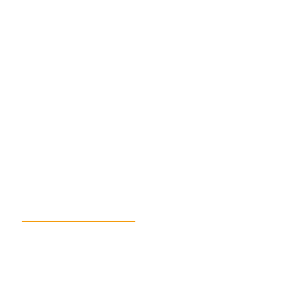 | **Corner brackets** `lt-corner-brackets` Four corner brackets draw themselves around a clear space for a name. | 4 s | Brackets `#FFFFFF` Accent line `#F5A524` |
|  | **Underline sweep** `lt-underline-sweep` A long line sweeps across with a travelling dot, then a shorter line follows. | 4 s | Line `#FFFFFF` Dot `#2EC4B6` Short line `#4C8DFF` |
|  | **Glass card** `lt-glass-card` A translucent dark card rises with a coloured edge and a soft highlight. | 4 s | Card `#0F1115` Edge `#2EC4B6` Highlight `#FFFFFF` |
|  | **Angled slab** `lt-angled` A slanted slab slices in with a thin parallel stripe. | 4 s | Slab `#F5A524` Stripe `#0F1115` |
|  | **Dots and line** `lt-dots-line` Three dots pop in a row, then a line and a bar extend from them. | 4 s | Dot 1 `#4C8DFF` Dot 2 `#2EC4B6` Dot 3 `#F5A524` Bar `#FFFFFF` |
| 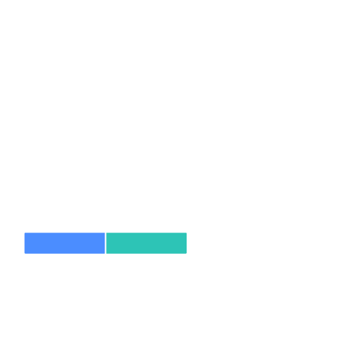 | **Split reveal** `lt-split-reveal` Two bars rush in from opposite sides and meet to form a title strip. | 4 s | Left bar `#4C8DFF` Right bar `#2EC4B6` Seam `#FFFFFF` |
|  | **Corner tag** `lt-corner-tag` A tag with a round badge slides in on the right of the frame. | 4 s | Tag `#0F1115` Badge `#F5A524` Badge mark `#FFFFFF` |

## Call to action (10)

| Preview | Asset | Length | Colours |
| --- | --- | --- | --- |
| 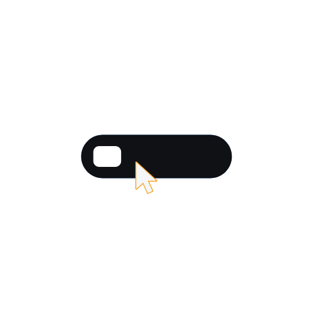 | **Subscribe click** `cta-subscribe-click` A cursor glides to a play-button pill and clicks it; the pill switches to its pressed colour. | 3 s, loops | Pill `#4C8DFF` Pressed pill `#0F1115` Icon `#FFFFFF` Cursor `#F4F6FA` Cursor outline `#F5A524` |
|  | **Bell ring** `cta-bell-ring` A notification bell swings back and forth while sound arcs pulse out. | 3 s, loops | Bell `#F5A524` Clapper `#0F1115` Sound arcs `#FFFFFF` |
|  | **Like thumb** `cta-like-thumb` A thumbs-up pops with a burst of short lines. | 3 s, loops | Hand `#4C8DFF` Cuff `#0F1115` Burst `#F5A524` |
|  | **Comment bubble** `cta-comment-bubble` A speech bubble pops up and three typing dots bounce inside it. | 3 s, loops | Bubble `#FFFFFF` Dots `#4C8DFF` |
|  | **Share arrow** `cta-share-arrow` A curved arrow springs forward from a round button. | 3 s, loops | Button `#2EC4B6` Arrow `#FFFFFF` |
|  | **Follow plus** `cta-follow-plus` A round plus button spins in, turns to a tick and back, with a pulse ring. | 3 s, loops | Button `#4C8DFF` Mark `#FFFFFF` Ring `#2EC4B6` |
| 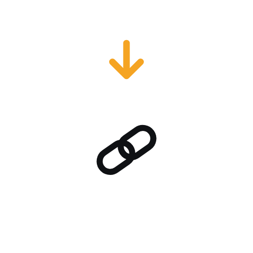 | **Link pointer** `cta-link-pointer` A chain-link badge with an arrow bouncing down towards it. | 3 s, loops | Badge `#FFFFFF` Link `#0F1115` Arrow `#F5A524` |
|  | **Swipe up** `cta-swipe-up` Three chevrons light up in a rising cascade. | 3 s, loops | Chevrons `#FFFFFF` Glow `#2EC4B6` |
|  | **Five-star rating** `cta-five-star` Five stars pop in one after another and fill with colour. | 3 s, loops | Stars `#F5A524` Empty stars `#FFFFFF` |
| 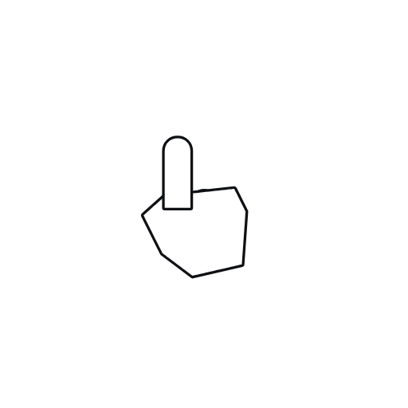 | **Tap here** `cta-tap-here` A pointing finger taps and sends out ripple rings. | 3 s, loops | Hand `#FFFFFF` Outline `#0F1115` Ripple `#2EC4B6` |

## Callouts (10)

| Preview | Asset | Length | Colours |
| --- | --- | --- | --- |
| 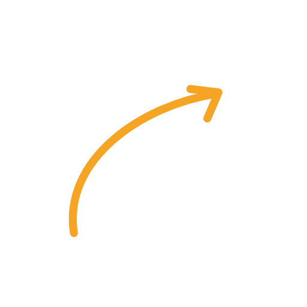 | **Curved arrow** `co-arrow-curved` A hand-drawn curved arrow sketches itself on, then its head snaps into place. | 3 s | Arrow `#F5A524` |
| 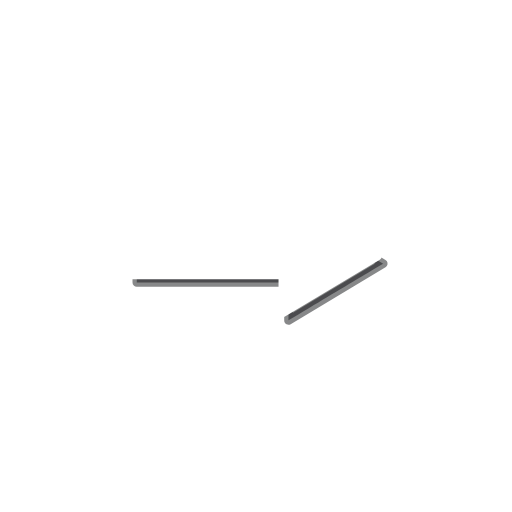 | **Nudging arrow** `co-arrow-straight` A bold straight arrow nudges towards its target again and again. | 3 s, loops | Arrow `#FFFFFF` Shadow `#0F1115` |
| 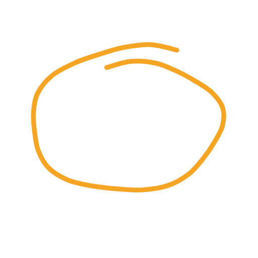 | **Circle scribble** `co-circle-scribble` A loose pen circle scribbles around a subject, overlapping at the end like a real marker. | 3 s | Marker `#F5A524` |
| 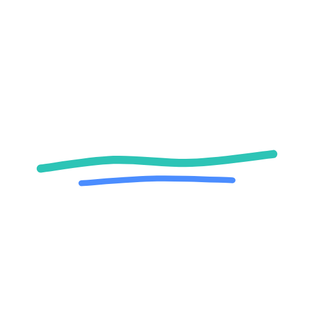 | **Swoosh underline** `co-underline` A brush-like swoosh underlines a word, with a second shorter stroke. | 3 s | Main stroke `#2EC4B6` Second stroke `#4C8DFF` |
|  | **Highlight swipe** `co-highlight-swipe` A translucent highlighter band swipes across from left to right. | 3 s | Band `#F5A524` |
|  | **Focus brackets** `co-brackets` Square brackets close in from both sides to frame the subject, then breathe. | 3 s, loops | Brackets `#FFFFFF` |
| 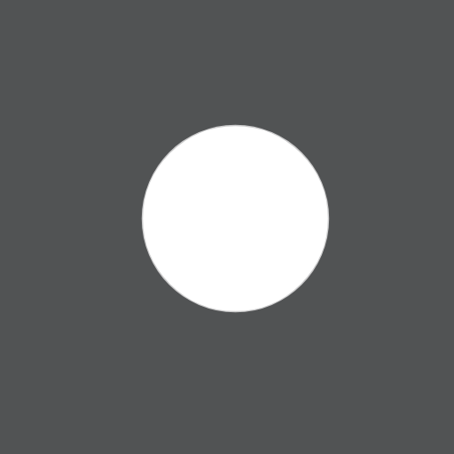 | **Spotlight** `co-spotlight` The frame dims around a circle of light that settles on the subject. | 3 s | Dim `#0F1115` Rim `#FFFFFF` |
|  | **Exclamation badge** `co-exclamation` A round warning badge pops in and gives a quick shake every loop. | 3 s, loops | Badge `#F5A524` Mark `#0F1115` |
|  | **Check stamp** `co-check-stamp` A circle stamps down and a tick draws itself inside. | 3 s | Circle `#2EC4B6` Tick `#FFFFFF` |
|  | **Cross stamp** `co-cross-stamp` A circle stamps down and a cross strikes through it. | 3 s | Circle `#0F1115` Cross `#F5A524` |

## Reactions (8)

| Preview | Asset | Length | Colours |
| --- | --- | --- | --- |
| 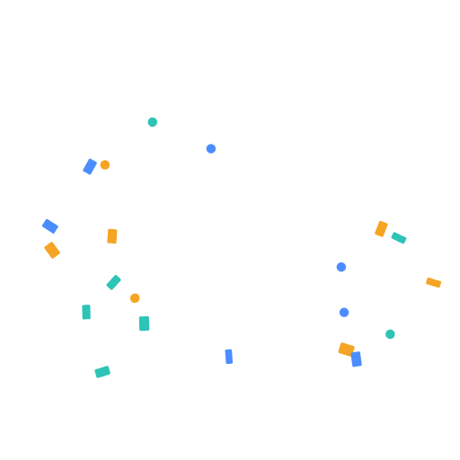 | **Confetti burst** `rx-confetti` Confetti bursts from the centre, tumbles and drifts down, then bursts again. | 3 s, loops | Confetti 1 `#4C8DFF` Confetti 2 `#2EC4B6` Confetti 3 `#F5A524` Confetti 4 `#FFFFFF` |
| 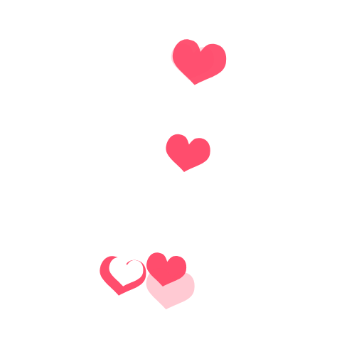 | **Floating hearts** `rx-hearts` Hearts float up and sway, fading as they rise, in a steady stream. | 3 s, loops | Hearts `#FF4D6D` Soft hearts `#FFFFFF` |
|  | **Sparkles** `rx-sparkles` Four-point sparkles twinkle in and out at different moments. | 3 s, loops | Sparkles `#F5A524` Small sparkles `#FFFFFF` |
| 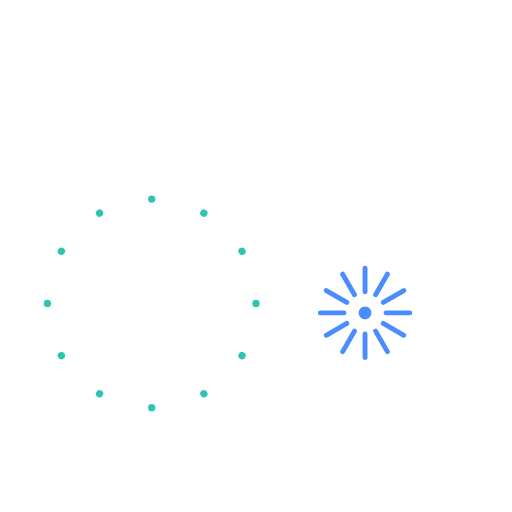 | **Fireworks** `rx-fireworks` Three fireworks burst one after another in radiating streaks. | 3 s, loops | Burst 1 `#F5A524` Burst 2 `#2EC4B6` Burst 3 `#4C8DFF` |
|  | **Impact lines** `rx-clap-lines` Comic-style impact lines flash out from a point, like a clap or a hit. | 3 s, loops | Lines `#FFFFFF` Accent `#F5A524` |
|  | **Fire** `rx-fire` A flickering flame with layered tongues of colour. | 3 s, loops | Outer flame `#FF6B3D` Middle flame `#F5A524` Core `#FFFFFF` |
| 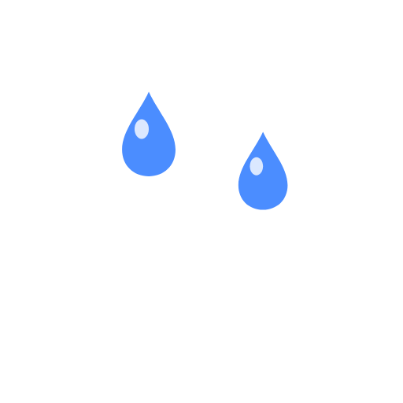 | **Tears** `rx-tears` Teardrops well up and fall in two streams. | 3 s, loops | Drops `#4C8DFF` Shine `#FFFFFF` |
| 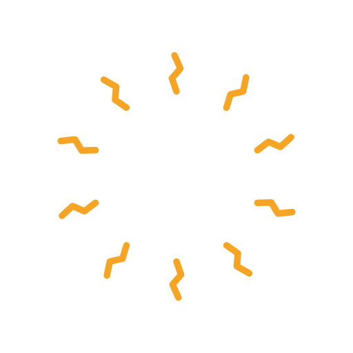 | **Shock lines** `rx-shock-lines` Jagged lines jolt around the centre for a shocked or surprised moment. | 3 s, loops | Lines `#F5A524` Inner lines `#FFFFFF` |

## Sri Lankan seasons (6)

| Preview | Asset | Length | Colours |
| --- | --- | --- | --- |
|  | **New Year sun and lamp** `sl-avurudu-sun` For Sinhala and Tamil New Year: a rising sun with turning rays above a lit oil lamp. | 4 s, loops | Sun `#F5A524` Rays `#FFD166` Lamp `#C9822B` Flame `#FF6B3D` Flame core `#FFFFFF` |
| 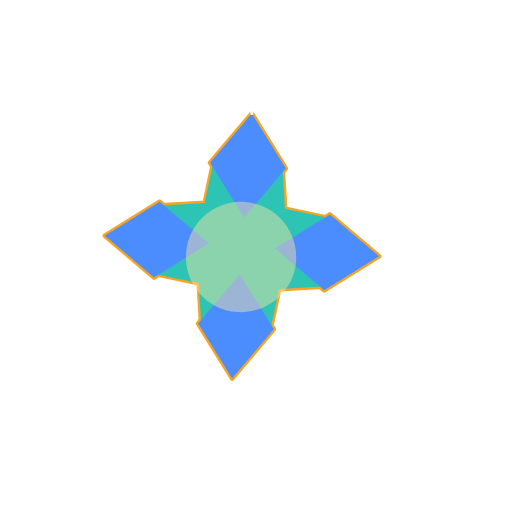 | **Vesak lantern** `sl-vesak-lantern` An original geometric Vesak lantern that sways gently, its tassels swinging and its centre glowing. | 4 s, loops | Frame `#F5A524` Panels `#2EC4B6` Glow `#FFE7A3` Tassels `#FFFFFF` Accent `#4C8DFF` |
| 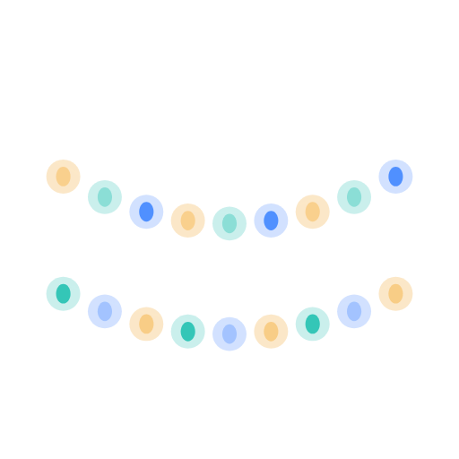 | **Poson lights** `sl-poson-lights` Strings of small lamps swing between two points and twinkle in a chasing pattern. | 4 s, loops | Wire `#FFFFFF` Lights 1 `#F5A524` Lights 2 `#2EC4B6` Lights 3 `#4C8DFF` |
|  | **Christmas star** `sl-christmas-star` A five-point star glows with long turning rays and small twinkles. | 4 s, loops | Star `#F5A524` Rays `#FFFFFF` Twinkles `#2EC4B6` |
|  | **Deepavali lamp** `sl-deepavali-lamp` A clay oil lamp with a dancing flame and a soft warm glow, for Deepavali. | 4 s, loops | Lamp `#C2552B` Pattern `#F5A524` Flame `#FF6B3D` Flame core `#FFFFFF` Glow `#FFD166` |
|  | **Crescent and stars** `sl-crescent-stars` A crescent moon rocks gently while stars twinkle around it, for Ramazan and Hajj. | 4 s, loops | Moon `#F5A524` Stars `#FFFFFF` Halo `#2EC4B6` |

## Transitions (8)

| Preview | Asset | Length | Colours |
| --- | --- | --- | --- |
| 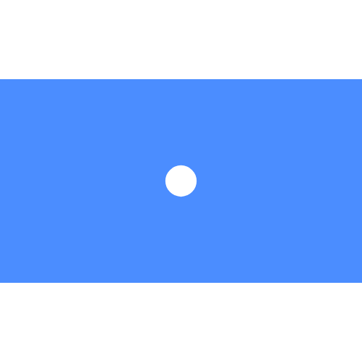 | **Circle burst** `tr-circle-burst` A circle bursts out to fill the frame, then opens from the middle to reveal the next shot. | 2 s | Fill `#4C8DFF` Edge `#2EC4B6` |
|  | **Slide panels** `tr-slide-panels` Three coloured panels sweep across one after another and slide away. | 2 s | Panel 1 `#F5A524` Panel 2 `#2EC4B6` Panel 3 `#4C8DFF` |
|  | **Diagonal wipe** `tr-diagonal-wipe` A slanted band sweeps across corner to corner with a contrasting leading edge. | 2 s | Band `#0F1115` Edge `#F5A524` |
| 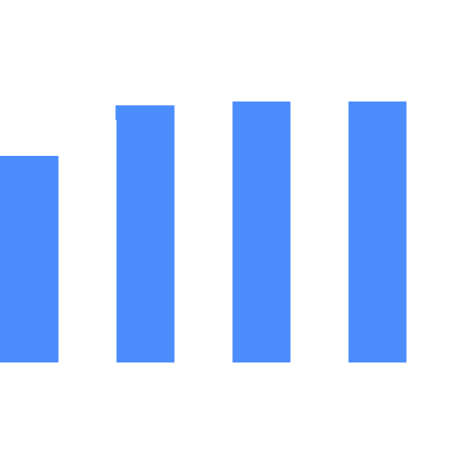 | **Vertical bars** `tr-vertical-bars` Vertical bars grow down in a ripple to cover the frame, then shrink away upwards. | 2 s | Bars 1 `#4C8DFF` Bars 2 `#FFFFFF` |
|  | **Diamond zoom** `tr-diamond-zoom` A turning diamond zooms in to fill the frame, then a diamond-shaped window opens through it. | 2 s | Fill `#2EC4B6` Outline `#FFFFFF` |
|  | **Split doors** `tr-split-doors` Two halves slide shut like doors with a bright seam, then slide open. | 2 s | Left door `#0F1115` Right door `#1B2030` Seam `#F5A524` |
| 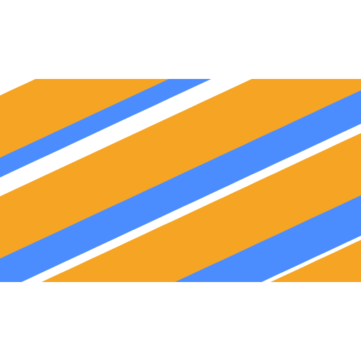 | **Diagonal stripes** `tr-diagonal-stripes` Slanted stripes slide in from alternating sides to cover the frame, then slide on through. | 2 s | Stripes 1 `#F5A524` Stripes 2 `#4C8DFF` |
| 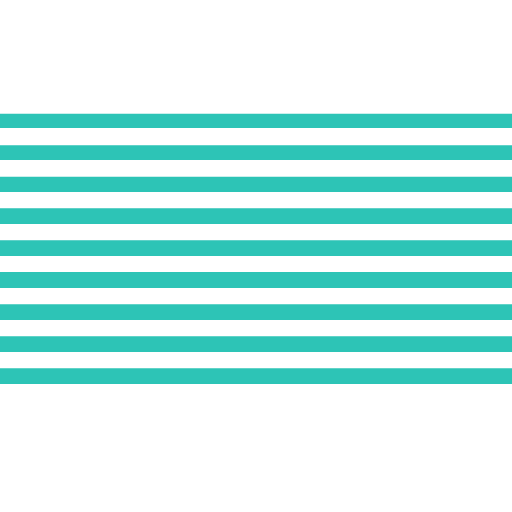 | **Blinds** `tr-blinds` Horizontal slats close like window blinds, then open again. | 2 s | Slats `#FFFFFF` Shade `#2EC4B6` |

## Status & infographics (8)

| Preview | Asset | Length | Colours |
| --- | --- | --- | --- |
| 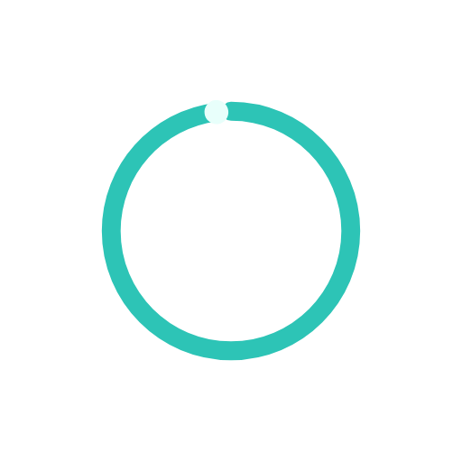 | **Progress ring** `st-progress-ring` A ring fills from empty to full with a dot riding its leading edge. | 3 s, loops | Track `#FFFFFF` Progress `#2EC4B6` Dot `#E8FFFC` |
|  | **Loading dots** `st-loading-dots` Three dots bounce and brighten in a wave. | 3 s, loops | Dot 1 `#4C8DFF` Dot 2 `#2EC4B6` Dot 3 `#F5A524` |
| 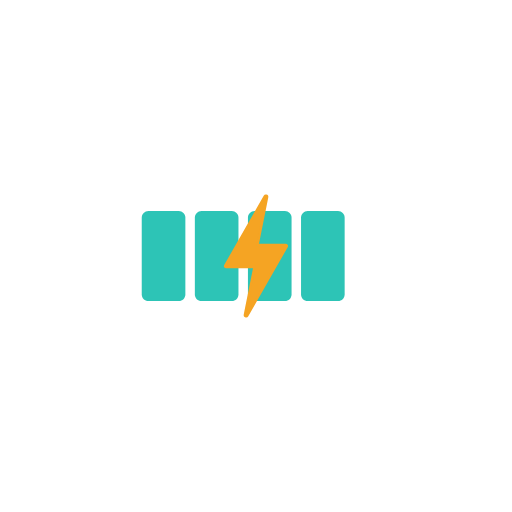 | **Battery charging** `st-battery` A battery charges cell by cell with a lightning mark, then resets. | 3 s, loops | Case `#FFFFFF` Cells `#2EC4B6` Bolt `#F5A524` |
|  | **Signal arcs** `st-wifi-bars` Signal arcs light up from the dot outward, like a connection being found. | 3 s, loops | Lit `#4C8DFF` Unlit `#FFFFFF` |
|  | **Gauge dial** `st-counter-dial` A gauge needle sweeps up with a little overshoot and settles, while the scale fills. | 3 s, loops | Dial `#FFFFFF` Fill `#F5A524` Needle `#4C8DFF` |
| 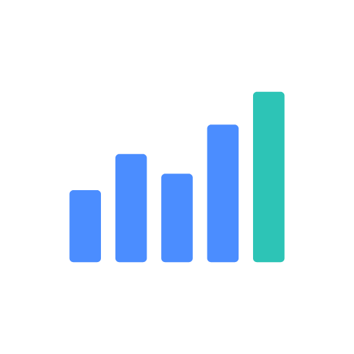 | **Growing bar chart** `st-bar-chart` Five bars grow in turn on a baseline, with a little bounce, and reset. | 3 s, loops | Bars `#4C8DFF` Top bar `#2EC4B6` Baseline `#FFFFFF` |
| 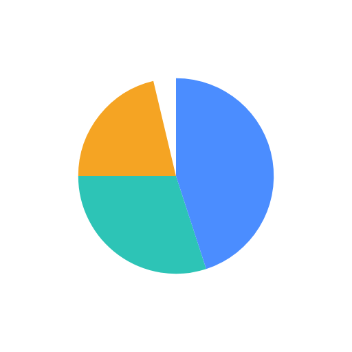 | **Pie fill** `st-pie-fill` A pie chart fills slice by slice around a ring of three colours. | 3 s, loops | Slice 1 `#4C8DFF` Slice 2 `#2EC4B6` Slice 3 `#F5A524` Background `#FFFFFF` |
| 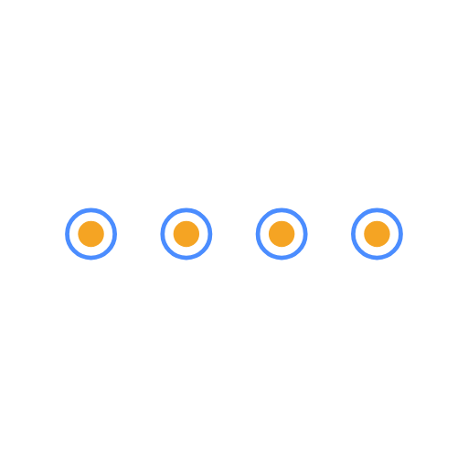 | **Timeline steps** `st-timeline-dots` A line draws across and four milestone dots pop on in sequence. | 3 s, loops | Line `#FFFFFF` Dots `#F5A524` Rings `#4C8DFF` |
